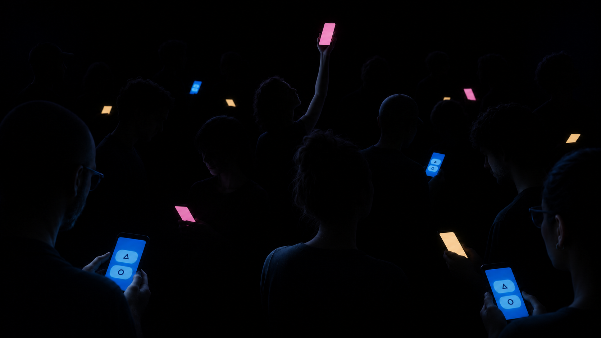
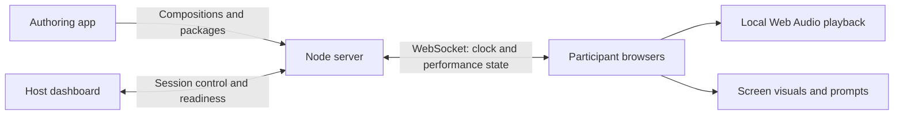

# Herd

Herd is a participatory sound and light performance for a room full of phones. Participants join through a browser, and each phone becomes a voice and a light source in a shared composition. Individual sounds gather into rhythms and harmonies. Choices on screen divide the room into groups that play different parts and come together again.

*Herd is a work in progress. The experience below describes the intended performance; the current implementation supports authoring and browser rehearsals.*



*Generated concept image.*

## The experience

You walk into a darkened room. Scattered phone screens glow among the people around you. There are chirps, squelches, little repeating phrases. You scan a QR code, tap to begin, and your phone adds its own sound.

At first, the room sounds like an orchestra tuning up. Then the pitches shift and the rhythms start to meet. Separate pulses settle into a steady chord, with screens lighting together across the crowd.

A question appears on your phone, followed by two colored shapes. You choose one. Around you, other people make their choices, and the music separates into two parts. One group answers the other. Later, another choice splits the room again, bringing four parts into the composition.

The piece can bring everyone back together, change the sound of a group, or let different participants follow different paths. Spatial passages are part of the vision too: sound and light moving through the room according to where people stand.

The [experience sketch](plan/experience.md) describes one possible piece. Herd's composition model lets artists write others.

## Making and running a piece

A composer builds a piece in the authoring app, arranging musical patterns, sounds, screen visuals, and participant prompts. The host opens a performance session and shares its QR code or join link. Participants open that link on their phones and tap **Begin** to enable audio.

The host dashboard shows who has joined and whether their devices are ready. From there, the host can start or stop the piece, place it on hold, and inspect session logs. During playback, each phone runs its assigned part. Prompts and choices can feed back into the composition.

| App | Used for |
| --- | --- |
| Authoring | Create compositions, edit devices and patterns, import media, and open rehearsals. |
| Host | Share the join link, monitor readiness, and control a session. |
| Participant | Play sound, display visuals, and respond to prompts on a phone. |
| Positioning Lab | Explore acoustic positioning workflows using simulated scan evidence. |

## Compositions

A Composition contains Programs, each with one to four Voices. Many participants can share a Voice. Each Voice combines a Pattern, an Instrument, a Visualizer, and a UI device.

```text
Composition
└── Programs
    └── Voices (1–4 per Program)
        ├── Pattern
        │   └── Step Events: triggers and parameter locks
        ├── Instrument
        ├── Visualizer
        └── UI: prompts and choices
```

Patterns determine when things happen. A Step Event can trigger a sound, a visual, both, or just a parameter change. Parameter Locks override device defaults for a single event: one note can have a different pitch or filter setting, while one visual event changes shape or color.

The authoring app includes synth and sampler settings, asset references, sampler zones, device defaults, and modulation routes. UI choices supply values that a composition can use to change device parameters or assign participants to different Voices. The model also allows participants to follow different Program cursors while sharing a clock and tempo.

Compositions travel as JSON or as `.herd.zip` packages containing `composition.json` and its referenced media. Imported package audio is restored for rehearsal playback.

See [creating compositions](plan/creating-compositions.md), the [composition schema](plan/composition-schema.md), and the [modulation system](plan/modulation-system.md) for the full design.

## Timing and playback

The server coordinates the session and provides a shared time reference. Each participant estimates its clock offset through WebSocket exchanges and runs audio and visuals locally against the performance timeline. Audio uses the browser's Web Audio API.

The timing design allows phones to play different parts while staying on the same musical clock. Program changes and participant choices have defined musical boundaries so that a change can take effect at the end of a pattern or another authored transition point. The [timing model](plan/timing-model.md) covers scheduling, independent cursors, late joins, and recovery requirements.

Spatial composition is still experimental. The Positioning Lab supports device labels, roles, chirp profiles, simulated scans, a relative layout preview, and JSON evidence export. Real acoustic measurement and physical accuracy validation remain to be implemented. See [acoustic positioning](plan/acoustic-positioning.md).

## Architecture

The apps use React and TypeScript. A Node server handles WebSocket session coordination, creator APIs, authentication, and package storage. Shared packages define the composition format, runtime behavior, and network protocol.



| Directory | Contents |
| --- | --- |
| `apps/authoring` | Composition editor and package import/export |
| `apps/host` | Performance dashboard |
| `apps/participant` | Phone client and browser audio playback |
| `apps/positioning-lab` | Positioning experiments |
| `apps/server` | Session coordination, creator APIs, and persistence adapters |
| `packages/composition` | Composition types, validation, and fixtures |
| `packages/runtime` | Shared performance and synthesis logic |
| `packages/protocol` | Client/server message types |
| `plan` | Experience, system design, and implementation plans |

## Run locally

Use a Node.js version compatible with Vite 8 (20.19+ or 22.12+) and the workspace's pinned pnpm version, `10.28.2`.

```sh
pnpm install
pnpm dev
```

To check types and tests, then build the apps:

```sh
pnpm check
pnpm build
```

With the server running, `pnpm smoke` checks its health endpoints and session creation. It uses `http://localhost:8787` by default; set `SMOKE_BASE_URL` to check another server.

## Local addresses

When `pnpm dev` is running:

- Host: http://localhost:5173
- Participant: http://localhost:5174
- Authoring: http://localhost:5175
- Positioning Lab: http://localhost:5176
- Server health: http://localhost:8787/healthz
- Server readiness: http://localhost:8787/readyz
- Server version: http://localhost:8787/version

The Positioning Lab dev server binds to `0.0.0.0` and uses the machine's LAN IPv4 address for its device join QR/link. Override the advertised device URL with `POSITIONING_LAB_PUBLIC_ORIGIN=http://<host>:5176 pnpm dev:positioning` when needed.

## Local HTTPS for phone microphone testing

iPhone Safari requires a secure origin for microphone capture on LAN URLs. Generate a local certificate with `mkcert`:

```sh
brew install mkcert
pnpm dev:cert
```

Then either run the production-style server over HTTPS:

```sh
HTTPS_CERT_FILE=.certs/herd-dev.pem HTTPS_KEY_FILE=.certs/herd-dev-key.pem pnpm --filter @herd/server start
```

Or run the hot dev stack. After `pnpm dev:cert`, dev mode automatically picks up `.certs/herd-dev.pem` and serves the API server and Positioning Lab over HTTPS:

```sh
pnpm dev
```

Install `.certs/herd-dev-rootCA.pem` on the iPhone and enable full trust in Settings > General > About > Certificate Trust Settings. After that, open the HTTPS LAN URL shown by the Positioning Lab QR/link.

## Authoring packages

Use Export Package to download a `.herd.zip` archive containing:

- `composition.json`
- media files referenced by the Composition assets

Use Import Package to restore the archive into local authoring state. Imported package media is rehydrated for rehearsal launch and Participant sampler playback.

## Accounts and package storage

The Authoring app includes an account panel for email magic-link login, saving authored Compositions, and creating uploadable package records through the local server API.

The server currently includes:

- Resend-backed magic-link endpoints with dev console fallback when `RESEND_API_KEY` is absent
- signed HttpOnly account sessions, session lookup, and logout
- creator Composition/package API endpoints
- an in-memory creator store for local development and a Postgres-backed store when `DATABASE_URL` is configured
- Postgres migrations for users, Compositions, Packages, auth sessions, upload metadata, Performance recovery/event tables, health reports, and positioning scan exports
- a migration runner: `pnpm --filter @herd/server db:migrate`
- Tigris-compatible signed upload URLs, upload confirmation metadata, and signed download URLs when `TIGRIS_ENDPOINT`, `TIGRIS_BUCKET`, `TIGRIS_ACCESS_KEY_ID`, and `TIGRIS_SECRET_ACCESS_KEY` are configured

Creator APIs infer ownership from the authenticated account session. Local owner-email bypass is available only when `ALLOW_DEV_OWNER_EMAIL=true`.

## Deployment

Built apps are served by the Node server at:

- `/host`
- `/join`
- `/authoring`
- `/positioning-lab`

Production deployment scaffolding includes `Dockerfile`, `fly.toml`, `.env.example`, GitHub Actions CI/deploy workflow, and `scripts/smoke.mjs`.

## Try a rehearsal

1. Open the Authoring URL and edit or create a Composition.
2. Use Open rehearsal to create a session from the active Composition.
3. Open the Participant URL from the Host QR code or join link.
4. Tap Begin on the Participant client to unlock audio.
5. Wait for Host readiness to become ready or degraded.
6. Start from the Host dashboard.
7. The Participant runs the authored Composition, plays scheduled synth events, displays visuals, and shows choice prompts.
8. Submit a Participant choice and confirm Host choice counts/logs update.
9. Stop from the Host dashboard.

## Implementation status

The current runtime supports browser rehearsals, composition editing, scheduled synth and sampler playback, screen visuals, and participant choices. The remaining work includes:

- Sessions are in memory only.
- Authoring saves to browser local storage, local `.herd.zip` archives, and authenticated server creator endpoints. The local runtime uses memory by default and switches to Postgres when `DATABASE_URL` is configured.
- Durable package upload/download requires Tigris environment variables and deployed object storage credentials.
- Magic-link delivery requires Resend credentials in production; dev mode logs usable verify links when no Resend key is configured.
- Account-scoped asset library browsing beyond Composition/package records is not complete.
- Participant runtime plays the minimal polyphonic SH-101-style synth path and embedded sampler audio zones; the full instrument engine is not implemented.
- The Host and Participant apps still need production-depth recovery, audit, warning, and permission flows before live public use.
- The Positioning Lab uses simulated scan evidence only; real acoustic chirp emission, microphone capture, correlation, and physical accuracy validation still require real devices.
- Account management and public safety review are still out of scope.

## Further reading

- [Performance lifecycle](plan/performances.md) and [host dashboard](plan/host-dashboard.md)
- [Participant assignment](plan/participant-assignment.md) and [authority model](plan/authority-model.md)
- [Audio engine](plan/audio-engine.md) and [authoring interface](plan/authoring-ui.md)
- [Failure modes](plan/failure-modes.md) and [privacy and consent](plan/privacy-and-consent.md)
- [Deployment](plan/deployment.md)
- [Glossary](plan/glossary.md)
