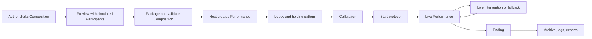

# Cross-Role Product Map

## Design Objective

Define how Herd moves from authored Composition to live Performance, and make the responsibilities of Authors, Hosts, Participants, and positioning operators explicit.

The core design problem is that Herd combines a creative authoring tool, a live operations console, and many synchronized mobile clients. The interaction model should keep those concerns separate while making shared state understandable.

## Target Users And Tasks

| User/Role | Primary Task | Context | Success State |
| --- | --- | --- | --- |
| Author | Build a Composition | Pre-performance creative work | Package validates and can run in preview or rehearsal. |
| Host | Run a Performance | Live room, time pressure, many devices | Session starts, stays observable, and can recover from failures. |
| Participant | Join and participate | Personal phone, minimal setup patience | Device joins, plays, responds, and recovers without explanation-heavy UI. |
| Positioning operator | Validate acoustic positioning | Lab/rehearsal with real devices | Scans produce usable measurements or clear failure evidence. |
| Observer/technician | Diagnose rehearsal problems | During test or installation setup | Logs and health states reveal root causes quickly. |

## Lifecycle Flow

## Cross-Surface Screen Inventory

| Surface | Screen/State | Purpose | Required Elements |
| --- | --- | --- | --- |
| Authoring | Composition Browser | Find, create, duplicate, import, and package Compositions. | List, warnings, package actions, rehearsal/start entry points. |
| Authoring | Composition Editor | Edit top-level structure and Program sequence. | Program Sequencer, active Program, global params, validation. |
| Authoring | Performance Preview | Simulate the live system before a room exists. | Simulated devices, choices, failures, cursor distribution. |
| Host | Setup | Create a Performance from a Composition. | Composition picker, venue/session name, late join, fallback policy. |
| Host | Lobby | Admit Participants and assess readiness. | QR, join URL, counts, readiness, permission/audio/asset status. |
| Host | Calibration | Prepare timing, audio, motion, and positioning. | Sync quality, tests, beacon candidates, fallback recommendation. |
| Host | Live | Monitor the room and intervene if needed. | Elapsed time, Voice populations, Program cursors, flags, health. |
| Participant | Join | Enter a session from a QR/link. | Session identity, public notice, continue action. |
| Participant | Notice/Unlock | Enter from physical venue notice, unlock audio, and grant required capabilities only when needed. | Physical QR/signage notice, lightweight join screen, permission requests, audio test, readiness feedback. |
| Participant | Holding | Wait in pre-show state. | Visual holding pattern, ready status, keep-page-open message. |
| Participant | Live | Execute Voice-local audio, visual, and UI Device behavior. | Full-screen visualizer, prompts, choices, recovery messages. |
| Lab | Test Controller | Run acoustic positioning experiments. | Devices, roles, chirp controls, scan controls, results, export. |
| Lab | Test Device | Act as beacon/listener/observer. | Consent, role, audio/mic state, scan status, local panic button. |

## Shared State Language

| State | Applies To | Meaning | UI Treatment |
| --- | --- | --- | --- |
| `ready` | Participant, session, capability group | Can participate as expected. | Quiet positive status. |
| `degraded` | Participant, session, feature | Can continue with reduced behavior. | Visible warning with recommended action. |
| `blocked` | Participant, session, export/start | Likely failure without override or fix. | Strong warning, explicit override if allowed. |
| `holding` | Participant/session | Joined but Performance has not started or is paused into holding. | Calm full-screen wait state. |
| `live` | Participant/session | Performance transport is running. | Minimal chrome, live visuals prioritized. |
| `recovering` | Participant | Client is resyncing, reconnecting, or resuming audio. | Clear instruction and progress feedback. |
| `fresh` | Positioning | Position estimate is recent and high confidence. | Normal status. |
| `stale` | Positioning | Last known position is being reused. | Mild warning and timeout visibility. |
| `unlocated` | Positioning | No useful position exists. | Fallback behavior and Host visibility. |

## Interaction Model

- Composition is a saved score, not a live event.
- Performance is the live execution context created from a Composition.
- Host controls session-level state, not every musical event.
- Server owns shared state, clock reference, membership, calibration, positioning coordination, and emergency fallback mode.
- Client owns local audio rendering, visual rendering, Pattern playback, UI display, and missed-event recovery.
- Participant choices usually apply at a musical boundary, with `patternLoopEnd` as the default.
- Program cursor divergence is normal unless a Composition opts into lockstep or bounded catch-up.

## Cross-Role Handoff Risks

| Risk | Design Response |
| --- | --- |
| Host mistakes independent Program cursors for failure. | Show cursor distribution as a designed state, with policy labels. |
| Participant thinks choice did nothing. | Acknowledge choice immediately and show when it applies. |
| Author creates a Composition that needs permissions without fallbacks. | Continuous validation with blocking errors for missing fallbacks where needed. |
| Positioning appears precise when it is only relative. | Label positioning as relative room layout; avoid exact-location language. |
| Live recovery depends on hidden technical state. | Expose actionable health groups and recommended actions. |
