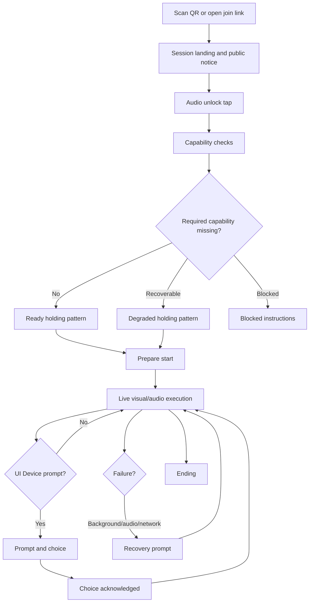

# Participant Mobile Client

## Design Objective

Let a Participant join a live Herd Performance with minimal friction, understand what the phone will do, grant only needed capabilities, and recover from common mobile-browser failures during the Performance.

The live screen should mostly be the artwork: sound, color, shape, motion, and Voice-local prompts. Operational UI should appear only when the Participant needs to act.

## Primary User Flow



## Screen And State Inventory

| Screen/State | Purpose | Required Elements | Notes |
| --- | --- | --- | --- |
| Venue Notice | Set expectations before the phone flow begins. | Door/signage copy near QR code: sound, flashing visuals, optional mic/motion use, no speech recording needed for normal operation, page can be closed to leave. | Use this for broad expectation-setting instead of an in-app checkbox gate. This is not a substitute for platform permission prompts or venue/legal review. |
| Join Landing | Confirm the Participant is entering the correct Performance. | Performance/session name, one-line notice, primary audio-start action, privacy/details link. | Avoid account-style onboarding and checkbox consent. |
| Audio Unlock | Satisfy mobile browser audio policy. | Single primary tap, test tone/visual confirmation, retry state. | Required before ready. |
| Permission Request | Ask for mic or motion only when needed. | Capability reason, platform prompt trigger, skip/deny path when allowed. | Do not request mic for Compositions that do not need it. These prompts are unavoidable when browser APIs require them. |
| Capability Check | Determine ready/degraded/blocked. | Clock sync, assets, audio, permissions, compatibility. | Should stream progress, not feel frozen. |
| Holding Pattern | Keep joined Participants active before start. | Full-screen visual, ready state, keep-page-open copy, reconnect status. | May include silent or subtle sound if approved. |
| Prepare Start | Confirm start has been scheduled. | Countdown or "starting soon", audio ready state. | Avoid exact promises if clock confidence is low. |
| Live Visualizer | Primary live state. | Full-screen visual output, local audio, hidden/minimal chrome. | The phone is a tile/pixel/instrument. |
| UI Prompt | Voice-local question or instruction. | Prompt text/symbol, timed reveal, optional choices. | Avoid large explanatory UI. |
| Choice Submitted | Confirm action was captured. | Selected state, boundary feedback if delayed. | Example: "Applies next loop." |
| Shaker Active | Tell Participant motion matters. | Simple gesture prompt, activity feedback, fallback when unavailable. | Should not require technical explanation. |
| Positioning Scan | Support scan windows. | Listening/emitting indication when useful, quiet/hold still if needed. | Keep privacy language available before mic use. |
| Recovery | Fix interrupted participation. | Tap to resume audio, reconnecting, resyncing, stale events skipped. | Preserve future timing, do not replay old events. |
| Late Join | Enter a Performance after start. | Syncing, entry behavior, waiting for boundary if needed. | Explain waiting only when it affects user. |
| Ending | Close the participation loop. | Visual ending, optional thanks/exit, no account prompt. | Keep short. |

## Low-Fidelity Wireframes

### Venue Notice

```text
This performance uses your phone as part of a shared sound and light system.

The web app may ask for microphone access to detect installation sounds for
approximate room positioning, and motion access for gesture-based sections.
It does not need to record speech for normal operation.

You can leave at any time by closing the page.

[QR CODE]
```

### Join Landing

```text
[Herd Performance Name]

Your phone becomes part of the room's sound and light.

                         [Tap to begin]

Privacy and device details
```

### Audio Unlock

```text
[Large central pulse]

Tap to wake audio

The page needs to stay open during the performance.

                         [Start audio]
```

### Holding Pattern

```text
[Full-screen calm visual field]

[QR CODE (so others can join)]

Ready

Waiting for the host to start
Keep this page open
```

### Live Prompt

```text
[Full-screen visual background]

             ?

        [green shape]   [blue shape]

              choose
```

### Recovery

```text
[Dimmed visual field]

Audio paused

Tap to resume. You will rejoin momentarily.

                         [Resume]
```

## Interaction Model

- Navigation: Participants should not navigate a multi-page app during the Performance. The client advances through states based on session and Composition state.
- Primary actions: continue, unlock audio, allow permission, choose, resume audio, leave.
- Secondary actions: view privacy details, retry, continue degraded if allowed.
- Feedback: capability checks update live; choices show immediate selected state; delayed actions state their boundary.
- Error recovery: stay in the current Performance context, resync clock, skip stale events, and rejoin at the current transport position.
- Permissions: ask just in time and only for Composition-required capabilities.

## State Rules

```text
State: Ready Holding
Entry: Join opened, audio unlocked, required assets loaded, clock sync acceptable.
Available actions: leave, keep page open.
Server events: prepareStart, closeLobby, forceHolding.
Exit: prepareStart received or Participant disconnects.

State: Live
Entry: startConfirmed received and local transport reaches start time.
Available actions: Voice-local UI Device actions only.
Failure handling: recover audio/network/visibility without replaying stale events.
Exit: Performance ended, emergency stop, or local leave.

State: Choice Pending Boundary
Entry: Participant selects a UI choice with delayed applyAt.
Available actions: change choice if Composition allows, wait.
Feedback: show selected choice and application boundary.
Exit: target boundary reached, timeout rule fires, or Program changes.
```

## Content Guidance

- Labels: use audience language: "Tap to wake audio", "Waiting for the host", "Choice received".
- Helper text: explain consequences only when the user can act.
- Empty states: "This device is connected. Waiting for setup."
- Loading states: "Syncing clock", "Loading sounds", "Joining room".
- Error states: "Audio paused", "Connection lost", "Motion unavailable", "Microphone unavailable".
- Success states: "Ready", "Choice received", "Rejoined".

## Edge Cases

- Participant denies microphone permission but the Composition has a non-spatial fallback.
- Participant denies motion permission during a shaker section.
- Device is muted at hardware level, but web APIs cannot confirm audible output.
- Page backgrounds or phone locks mid-Performance.
- Participant joins after calibration.
- Participant receives a start message late.
- Participant is assigned to a Voice whose assets failed to load.
- UI choice times out before selection.
- User refreshes the page and receives a new session-scoped Participant ID.

## Accessibility And Responsive Notes

- Keep text short and centered for quick comprehension in dark rooms.
- Ensure choice controls have large touch targets.
- Avoid relying on color alone for choices; pair color with shape or symbol.
- Announce permission and recovery states to assistive tech.
- Maintain strong contrast during operational prompts.
- Let motion-sensitive Participants continue when shaker behavior is optional or has fallback.
- Avoid flashing patterns that violate safe animation thresholds where possible.
