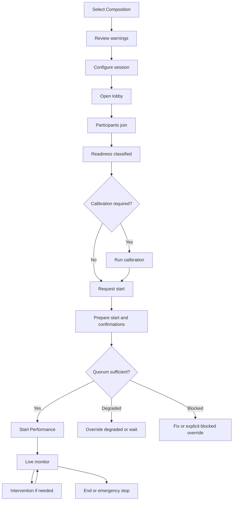

# Host Dashboard

## Design Objective

Give the Host a dense, calm, operational control surface for running a live Herd Performance without exposing the full authoring interface.

The dashboard should let the Host answer five questions quickly:

1. Can we start?
2. What is degraded?
3. What is happening now?
4. Who needs attention?
5. What can I do safely under pressure?

## Primary Host Flow



## Navigation Model

Recommended primary sections:

- Setup
- Lobby
- Calibration
- Live
- Participants
- Health
- Logs

Emergency controls should be globally reachable but protected from accidental activation.

## Screen And State Inventory

| Screen/State | Purpose | Required Elements | Notes |
| --- | --- | --- | --- |
| Setup | Create a Performance from a Composition. | Composition picker, venue/session name, late join toggle, fallback behavior, warnings. | Show blocking issues before opening lobby. |
| Lobby | Admit Participants and assess readiness. | QR, URL, counts, ready/degraded/blocked summary, assets, sync, permissions, audio. | This is the main pre-show screen. |
| Calibration | Prepare timing, audio, motion, and positioning. | Clock sync, audio test, motion, mic, beacon candidates, positioning mode, scan quality. | Continue with degraded behavior when allowed. |
| Start Confirmation | Schedule the beginning. | Start request, scheduled time, client confirmations, quorum, override controls. | Blocked override must be explicit. |
| Live | Monitor current Performance state. | Elapsed time, Voice population, Program cursor distribution, choice counts, flags, positioning, fallback. | Do not assume one active Program. |
| Participants | Inspect individual devices. | ID/label, Program, Voice, sync, network, audio, visibility, permissions, positioning, heartbeat. | Supports ignore, reconnect instruction, state history. |
| Health | Summarize system risk. | Clock, network, audio, permissions, positioning, server, assets, progression. | Each group needs a recommended action. |
| Emergency | Intervene safely. | Stop, pause, holding pattern, disable positioning, disable shaker, mute, force Program, reconnect. | Confirm destructive or audible actions. |
| Logs | Diagnose and rehearse. | Compact event stream, filters, export. | Useful after rehearsal. |

## Low-Fidelity Wireframes

### Lobby

```text
[Herd Host]  Performance: Night Garden                 [Emergency]

Setup | Lobby | Calibration | Live | Participants | Health | Logs

+---------------------+  +-----------------------------------------+
| Join this session   |  | Readiness                               |
|                     |  | Ready       42                           |
| [QR CODE]           |  | Degraded     6                           |
| herd.local/j/8K4P   |  | Blocked      2                           |
|                     |  | Status: degraded, start allowed          |
+---------------------+  +-----------------------------------------+

+---------------------------------------------------------------+
| Checks                                                        |
| Clock sync        healthy 44   degraded 5   failed 1          |
| Assets            healthy 48   degraded 0   failed 2          |
| Audio unlock       healthy 45   degraded 0   failed 5          |
| Permissions        healthy 39   degraded 9   failed 2          |
+---------------------------------------------------------------+

                                        [Close lobby] [Start...]
```

### Live

```text
[Herd Host]  Live  08:42 elapsed                       [Emergency]

Setup | Lobby | Calibration | Live | Participants | Health | Logs

+-----------------------+ +-----------------------+ +-------------+
| Voice Population      | | Program Cursors       | | Fallback    |
| Voice 1: 18           | | intro: 2              | | none        |
| Voice 2: 14           | | choose-group: 38      | |             |
| Voice 3: 11           | | duet-a: 8             | | Positioning |
| Voice 4: 7            | | finale: 0             | | fresh 41    |
+-----------------------+ +-----------------------+ | stale 7     |
                                                    | unlocated 2 |
                                                    +-------------+

+---------------------------------------------------------------+
| Current choices                                               |
| Green triangle 29    Blue circle 21                           |
+---------------------------------------------------------------+

                                  [Force holding] [Queue Program]
```

### Participant Detail Drawer

```text
Participant P-184        [Ignore] [Send reconnect instructions]

Voice: Green Triangle
Program: choose-group
Clock: healthy, offset +12 ms, jitter 8 ms
Network: degraded, last heartbeat 4.2s
Audio: running
Visibility: foreground
Permissions: mic denied, motion granted
Position: unlocated

Recent changes
12:08:14 joined
12:08:21 audio unlocked
12:09:02 mic denied
12:10:44 selected green
```

## Interaction Model

- Navigation: section tabs, with emergency always available.
- Primary actions: open/close lobby, calibrate, start, stop, force holding, disable risky features, queue/force Program where allowed.
- Secondary actions: inspect Participant, mark ignored, broadcast reconnect, export logs.
- Feedback: readiness classification updates continuously; every Host action is logged with Host ID and timestamp.
- Error recovery: surface recommended action per health group instead of only raw metrics.
- Permissions: Host sees operational permission state, not personal identity.

## Readiness Classification

Host readiness is the pre-start launch confidence for the selected Performance. It combines Composition warnings, connected Participant count, asset status, clock sync, audio unlock, required permissions/capabilities, calibration results, positioning quality when required, and active fallback policy.

| Classification | Meaning | Host Action |
| --- | --- | --- |
| `ready` | Enough clients have required assets, sync, audio unlock, and required permissions. | Start normally. |
| `degraded` | Performance can start with some disabled or unreliable behavior. | Start with warning or wait/fix. |
| `blocked` | Start would likely fail or violate Composition requirements. | Fix or perform explicit blocked override if product policy allows it. |

Readiness should surface top blockers and audience-visible impact before raw metrics.

## Emergency Control Rules

- Emergency panel opens quickly but actions require confirmation when they stop audio, force global state, or affect all clients.
- Stop Performance is the most protected action.
- Force holding pattern should be fast, because it is a recovery action.
- Disable positioning and disable shaker sections should show the affected Composition behavior.
- Force Program must distinguish all Participants from selected Participants.
- Every emergency action is written to Logs immediately.

## Content Guidance

- Use operational labels: "Ready to start", "Start allowed with degradation", "Clock sync unstable".
- Recommended actions should be concrete: "Wait for 3 clients to finish loading assets", "Disable positioning", "Send reconnect instruction".
- Avoid celebratory live copy. The Host is working.
- Do not hide advanced details, but keep them behind drill-downs.

## Edge Cases

- Host starts with degraded permission state.
- Host tries to start while a Composition warning is blocking.
- Many Participants fall back to Voice 1.
- A late join enters during a Program with missed choices.
- Server restarts during a rehearsal.
- Program cursor distribution diverges unexpectedly in a lockstep Composition.
- Positioning scan quality collapses mid-Performance.
- Host accidentally opens emergency controls.

## Accessibility And Responsive Notes

- Dashboard should work best on laptop/tablet width; mobile Host use can be secondary.
- Dense tables need keyboard navigation and visible focus.
- Warning colors need labels and icons, not color alone.
- Critical actions need distinct visual hierarchy and confirmation.
- Event log should be screen-reader navigable and filterable.
