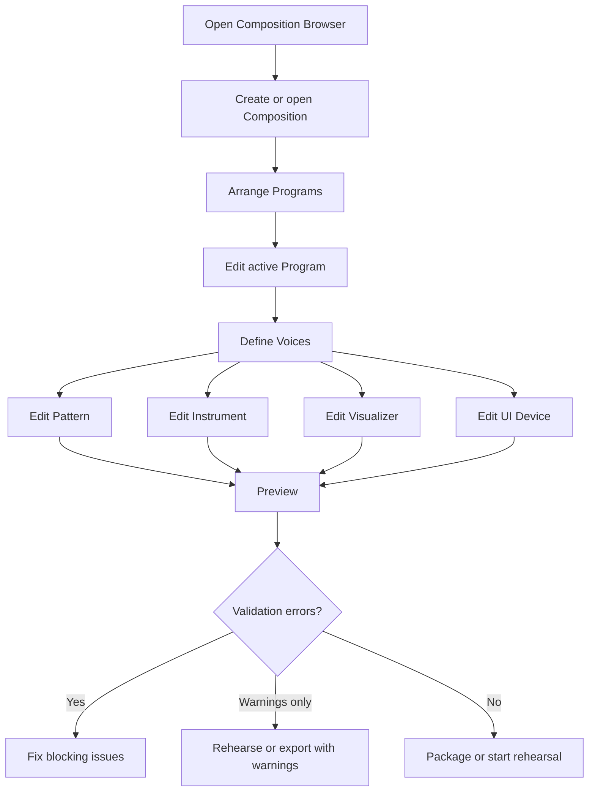

# Authoring App

## Design Objective

Let an artist build a room-scale participatory Composition without editing JSON directly.

The authoring UI should feel closer to an electronic music workstation than a slide editor. The strongest interaction references from the planning docs are Elektron-style sequencing and parameter locks, plus Bitwig-style modulation visibility.

## Primary Author Flow



## Primary Areas

| Area | Purpose | Required Elements |
| --- | --- | --- |
| Composition Browser | Manage saved Compositions. | Create, duplicate, rename, import, export, package, open rehearsal, start Performance. |
| Composition Editor | Top-level workspace. | Metadata, Program Sequencer, active Program, globals, presets, assets, validation. |
| Program Sequencer | Define default Program order. | Linear steps, reorder, duplicate, rename, initial Program, transition boundary, completion rule. |
| Program Editor | Define one section of the piece. | Duration/completion, active Voices, parameters, transition behavior, warnings. |
| Voice Editor | Core working surface. | Vertical device stack: Pattern, Instrument, Visualizer, UI Device. |
| Pattern Editor | Generate Step Events. | Step sequencer up to 64 steps, layer toggles, Instrument Triggers, Visualizer Triggers, Parameter Locks, probability later. |
| Instrument Editor | Define local sound. | Sampler, polyphonic SH-101-style synth, envelope, filter, gain, FX/sends. |
| Visualizer Editor | Define local screen output. | HSBA, Cel shape, intensity, decay, placement, motion, room-grid preview. |
| UI Device Editor | Define prompts and choices. | Timed prompts, choices, actions, boundary, visibility, timeout, default. |
| Modulation Mode | Route normalized sources to typed targets. | Source selector, target highlights, amount/range, invalid route warnings. |
| Asset Manager | Manage referenced media. | Import, preview, replace, usage, package, remove unused. |
| Performance Preview | Simulate room behavior. | Simulated Participants, choices, late join, permission failures, cursor distribution. |

## Recommended Workspace Layout

```text
+------------------------------------------------------------------------+
| Composition: Night Garden                         [Preview] [Package]   |
+------------------------------------------------------------------------+
| Programs: intro | choose-group | duet-a | finale             Warnings 3 |
+------------------------------------------------------------------------+
| Program: choose-group                                                 |
| Completion: 8 pattern loops     Boundary: patternLoopEnd               |
+------------------------------------------------------------------------+
| Voice 1: Green Triangle                                                |
| +--------------------------------------------------------------------+ |
| | Pattern                                                            | |
| | Step Sequencer                                                     | |
| +--------------------------------------------------------------------+ |
| +--------------------------------------------------------------------+ |
| | Instrument                                                         | |
| | Sampler                                                            | |
| +--------------------------------------------------------------------+ |
| +--------------------------------------------------------------------+ |
| | Visualizer                                                         | |
| | Green wash                                                         | |
| +--------------------------------------------------------------------+ |
| +--------------------------------------------------------------------+ |
| | UI Device                                                          | |
| | Choice                                                             | |
| +--------------------------------------------------------------------+ |
| Voice 2: Blue Circle                                                   |
| +--------------------------------------------------------------------+ |
| | Pattern | Instrument | Visualizer | UI Device collapsed              | |
| +--------------------------------------------------------------------+ |
+------------------------------------------------------------------------+
| Validation: missing fallback for shaker when motion denied              |
+------------------------------------------------------------------------+
```

## Composition Browser

### Screen Requirements

- Search/filter saved Compositions.
- Show name, last modified date, required assets, expected capabilities, warnings.
- Actions: create, duplicate, rename, import, export, package assets, open rehearsal, start Performance.
- Empty state: explain how to create or import a Composition.
- Import failure state: invalid schema, missing assets, unsupported version.

### Interaction Notes

- Starting a Performance from here should still route through Host setup.
- Packaging should block on errors and allow warnings only with explicit acknowledgement.

## Program Sequencer

### Required Interactions

- Add Program.
- Drag reorder Programs.
- Duplicate Program.
- Rename Program.
- Set initial Program.
- Set default transition boundary.
- Define Program completion rule.
- Define allowed jump targets for UI actions.

### Wireframe

```text
Program Sequencer

[initial] intro        completion: 4 loops       -> choose-group
          choose-group completion: UI choice     -> duet-a | duet-b
          duet-a       completion: 8 loops       -> finale
          finale       completion: host/end      -> none

[+ Add Program]
```

## Voice Editor

Each Program should support one to four Voices. Each Voice owns:

- Pattern
- Instrument
- Visualizer
- UI Device

Recommended interactions:

- Add/remove Voice.
- Rename Voice.
- Assign color/shape identity.
- Reference Voice preset.
- Override preset values in the current Program.
- Copy/paste Voice.
- Save as preset.
- Reset to preset.
- Detach from preset.

## Pattern Editor

### Step Sequencer

```text
Step Sequencer

Steps: 64     Loop: 4 bars     Repetitions: 8     Tempo: composition

01 02 03 04 05 06 07 08 09 10 11 12 13 14 15 16
[x][ ][ ][x][ ][ ][x][ ][x][ ][ ][x][ ][ ][x][ ]
[x][ ][ ][x][ ][ ][x][ ][x][ ][ ][x][ ][ ][x][ ]
[x][ ][ ][x][ ][ ][x][ ][x][ ][ ][x][ ][ ][x][ ]
[x][ ][ ][x][ ][ ][x][ ][x][ ][ ][x][ ][ ][x][ ]

Selected step: 04
Layers: [x] Instrument Triggers   [ ] Visualizer Triggers   [x] Parameter Locks
Step Event: instrument trigger on, visualizer trigger off
Note defaults: from Instrument
Locks: pitch C3, velocity 92, filter cutoff +24, Cel brightness +0.3
```

Step count should be configurable up to 64. The editor should preserve a stable 16-step row grouping so 64-step Patterns read as four rows rather than one long strip.

A Pattern editor should have layer toggles for Instrument Triggers, Visualizer Triggers, and Parameter Locks. The Instrument Trigger and Visualizer Trigger toggles control whether the author is seeing and editing trigger data. If both trigger layers are off, the author is editing Parameter Locks.

A Step Event is the sequencer-step object with authored data. It can contain an Instrument Trigger, a Visualizer Trigger, both, or neither. Instrument and Visualizer devices define defaults; Step Event Parameter Locks override those defaults for the selected event. Parameter-only Step Events are valid and useful for changing parameters at a musical time without creating a note or visual Cel.

### Step Event Lock Capture

The Step Event editor should support an armed capture workflow:

```text
Selected step: 04

Layers: [ ] Instrument Triggers   [ ] Visualizer Triggers   [x] Parameter Locks
Step Event: no trigger, parameter locks only
Locks:
- filter cutoff: +24
- Cel brightness: +0.3

[+ Create lock]

Lock capture armed: touch or modify any control on a device.
```

When lock capture is armed, the next touched or modified control on the Instrument or Visualizer becomes the lock target. The edited value becomes the locked value for the selected Step Event, and the target control should visibly indicate that this Step Event locks it.

Step Events do not have Modulation Mode. This editor has Lock Capture only. Modulation Mode is entered from Instruments or Visualizers.

### Shaker Pattern

- Motion sensitivity.
- Directional-change detection.
- Quantization amount.
- Tempo, step count, and repetition count for coordination.
- Derived modulation sources: intensity, step proximity, consistency.
- Fallback behavior when motion permission is unavailable.

## Instrument Editor

### Sampler

Recommended model:

- Pitch on x axis.
- Velocity on y axis.
- Zones define pitch and velocity ranges.
- Selected zone exposes sample slots.
- Multiple samples in a slot round-robin.

```text
Sampler

Velocity
high |      [zone 2] [zone 3]
     |
low  | [zone 1]
      -------------------------
       C1       C3       C5   Pitch

Selected zone: zone 1
Samples: kick-soft.wav, kick-alt.wav
Selected sample(s): kick-soft.wav
Root key: C2     Tuning: 0     Gain: -3 dB
Start: 0 ms      End: 430 ms   Loop: off
```

### Polyphonic SH-101-Style Synth

- VCO waveform mix for saw, pulse, sub oscillator, and noise.
- Pulse width.
- Pitch and tuning.
- Glide/portamento.
- LFO rate and routing.
- Filter cutoff and resonance.
- Filter envelope amount.
- VCA mode.
- ADSR envelope.
- Gain.
- Parameter lock support.
- Modulation target support.

The synth should model the immediacy and control layout of a Roland SH-101, but allow polyphonic playback so a Pattern can produce overlapping notes on one Participant device.

## Visualizer Editor

Required controls:

- Background HSBA.
- Cel shape.
- Cel HSBA.
- Intensity.
- Duration.
- Decay.
- Placement.
- Motion.
- Blend behavior.
- Position-aware behavior.
- Fallback when position is unknown.

Preview should include:

- One device preview.
- Simplified room grid preview.
- Fresh/stale/unlocated positioning simulation.

## UI Device Editor

Required controls:

- Prompt timing.
- Prompt text.
- Symbols or simple shapes.
- Choice buttons.
- Action mappings.
- Apply boundary.
- Visibility rules.
- Timeout behavior.
- Default choice.

Action types:

- Set Parameter.
- Queue Program.
- Assign Voice.
- Set flag.
- Change repetition count.
- Submit vote.

The editor must make immediate vs boundary-delayed actions obvious.

## Modulation Mode

### Interaction Rule

Modulation Mode belongs to target-owning devices: Instruments and Visualizers. It should be entered from the device that owns the controls being modulated. It is not a Step Event mode.

When modulation mode is active:

- Modulatable controls are highlighted.
- Existing modulation targets are visible.
- A selected source can be routed by pressing a target button on a control.
- Amount, range, curve, scope, and apply boundary are editable.
- Invalid routes are flagged immediately.

### Wireframe

```text
Modulation Source: participant.choice.group       Amount: +1.00

Voice assignment        [target]  source: choice.group  apply: loop end
Filter cutoff           [target]  source: none
Visualizer hue          [target]  source: position.x     amount: +0.45
Program jump target     [locked]  invalid: unsafe immediate jump
```

## Validation

Validation should always distinguish errors from warnings.

Errors block export or Performance start:

- Missing required asset.
- Unresolved Program reference.
- Invalid preset reference.
- Invalid modulation target.
- Device requires unavailable permission with no fallback.
- UI action hard-jumps immediately when not marked safe.

Warnings allow rehearsal with visibility:

- Many Participants could fall back to Voice 1.
- Shaker section has weak fallback.
- Pattern can run forever with no Host or UI exit.
- Position-aware behavior lacks strong non-spatial fallback.
- Composition exceeds expected Participant count.

## Performance Preview

Preview must support behaviors that are impossible to understand on one device:

- Simulate multiple Participants.
- Assign simulated Participants to Voices.
- Preview independent and synchronized Program progression.
- Preview UI choices.
- Preview late join.
- Preview no mic.
- Preview no motion.
- Preview unknown position.
- Preview Program cursor distribution.

## Accessibility And Responsive Notes

- Desktop-first authoring is acceptable, but controls should not rely on hover alone.
- All knobs/sliders need keyboard-editable numeric values.
- Sequencer steps need accessible names and states.
- Color choices need text/value representation.
- Validation should be navigable from issue to affected control.
- Modulation overlays must not obscure the value being edited.
