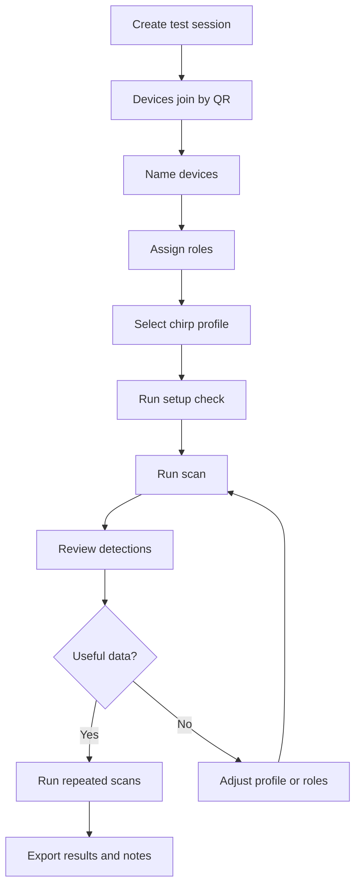

# Sonic Positioning Lab

## Design Objective

Create a standalone test environment for acoustic beacon/listener positioning before integrating positioning into the main Performance flow.

This lab should answer whether real phones in real rooms can emit, detect, and analyze scheduled chirps reliably enough for Herd's room-scale effects.

## Primary Operator Flow



## Controller Screen Inventory

| Screen/State | Purpose | Required Elements | Notes |
| --- | --- | --- | --- |
| Session Setup | Create a positioning test session. | Session name, QR, join URL, HTTPS status. | Real devices require secure context. |
| Device List | Track connected devices. | Device labels, roles, audio, mic, sample rate, clock sync. | Manual labels are important in physical rooms. |
| Role Assignment | Choose beacon/listener/backup/observer. | Role picker, beacon count, warnings for too few beacons. | Prefer stationary beacons. |
| Chirp Profile | Configure signal parameters. | Band, duration, shape, code, gain, slot, guard, repeats, thresholds. | Named presets should ship with defaults. |
| Scan Control | Run and stop scans. | Run one scan, repeated scans, stop all audio. | Stop all audio must be immediate. |
| Results | Inspect measurement quality. | Detection table, confidence, SNR, peak width, latency, misses. | Raw audio is not uploaded by default. |
| Layout Preview | Optional rough 2D solved layout. | Points, confidence, stale/unlocated state. | Must avoid implying exact location. |
| Export | Save evidence. | Metadata, measurements, notes, analysis mode. | Include enough data for later comparison. |

## Test Device Client Inventory

| Screen/State | Purpose | Required Elements | Notes |
| --- | --- | --- | --- |
| Join | Enter lab session. | Session name, consent intro, continue. | Separate from normal Participant flow. |
| Consent | Explain sound and microphone use. | Sound output, mic detection, no speech recording by default. | Diagnostic recording needs separate consent if added. |
| Audio Unlock | Prepare output. | Tap to unlock, output test state. | Required for beacons. |
| Mic Permission | Prepare listener role. | Request mic, denial path, local processing explanation. | Only when listener behavior is needed. |
| Role State | Show assigned role. | Beacon/listener/backup/observer, audio/mic/clock status. | Keep clear for physical debugging. |
| Scan Active | Show current scan status. | Emitting/listening/waiting, progress, local stop button. | Participants need a panic button. |
| Result State | Show latest local result. | Detections count, confidence, upload status. | Keep concise. |

## Controller Wireframe

```text
[Positioning Lab]  Session: north-gallery-test              [Stop all audio]

+--------------------+ +-----------------------------------------------+
| Join devices        | | Chirp profile                                 |
| [QR CODE]           | | Preset: audible-robust                        |
| herd.local/p/4TZ9   | | Gain: 0.45   Slot: 240 ms   Guard: 120 ms     |
+--------------------+ | Analysis: jsWorker                            |
                       +-----------------------------------------------+

+--------------------------------------------------------------------+
| Devices                                                            |
| Label        Role          Audio   Mic      Sync      Sample rate   |
| north wall   beacon        ready   n/a      good      48000         |
| table 1      beacon        ready   n/a      good      44100         |
| visitor A    listener      ready   granted  good      48000         |
| visitor B    listener      ready   denied   good      48000         |
+--------------------------------------------------------------------+

                         [Run one scan] [Run repeated scans] [Export]

+--------------------------------------------------------------------+
| Results                                                            |
| Listener   Beacon       Detected   SNR   Confidence   Processing    |
| visitor A  north wall   yes        21    0.86         34 ms         |
| visitor A  table 1      no         --    0.10         32 ms         |
+--------------------------------------------------------------------+
```

## Named Chirp Profiles

| Profile | Purpose | Design Notes |
| --- | --- | --- |
| `audible-short` | Quick low-disruption test. | Good for early device compatibility. |
| `audible-robust` | More reliable audible scan. | Useful when near-ultrasonic is unreliable. |
| `near-ultrasonic-test` | Check if target devices support high bands. | Use caution until safety and audibility are checked. |
| `noisy-room` | Improve detection in installation-like noise. | Longer chirps or higher guard intervals. |
| `long-guard-reverb` | Reverberant rooms. | Longer guard intervals to avoid echo corruption. |

## Measurement Export Requirements

Each export should include:

- Test session ID.
- Timestamp.
- Browser user agent.
- Device labels.
- Device roles.
- Sample rates.
- Clock sync stats.
- Chirp profile.
- Scan schedule.
- Per-listener/per-beacon detections.
- Arrival timestamps.
- Confidence.
- SNR.
- Peak width.
- Detected/missed flag.
- Analysis mode.
- Processing time.
- Optional solved coordinates.
- Operator notes.

Raw audio should not be included unless diagnostic recording mode has explicit Host and Participant consent.

## Interaction Model

- Navigation: controller is a single operational workspace with panels; device client is state-driven.
- Primary actions: assign roles, choose profile, run scan, stop all audio, export.
- Secondary actions: rename devices, adjust thresholds, compare analysis modes, add notes.
- Feedback: scans show schedule, live progress, detection quality, and whether results are fresh/stale/unlocated.
- Error recovery: bad scans should be visible as bad scans, not converted into misleading coordinates.
- Permissions: mic permission is requested only for listener behavior.

## Edge Cases

- Too few beacons connected.
- Beacons are moving or unstable.
- Listener denies microphone permission.
- Sample rates differ across devices.
- A beacon is muted or too quiet.
- Room reflections create broad correlation peaks.
- Near-ultrasonic output is not reproduced by some phones.
- JS Worker and WASM Worker disagree.
- Operator accidentally starts loud or repeated scans.

## Accessibility And Safety Notes

- Keep stop-all-audio visible at all times.
- Keep a local stop button on every test device.
- Warn before high-gain or near-ultrasonic tests.
- Avoid raw-audio recording by default.
- Use labels and confidence values, not only colors, for scan status.
- Treat solved layout as approximate and relative.

